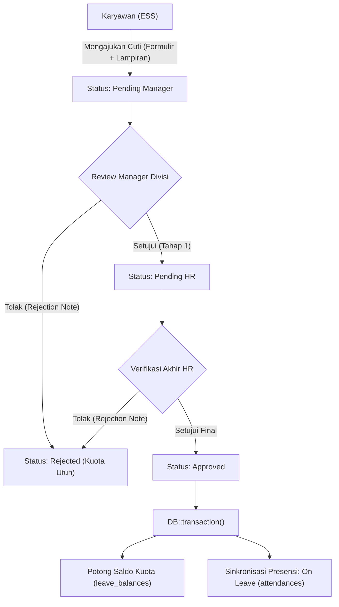
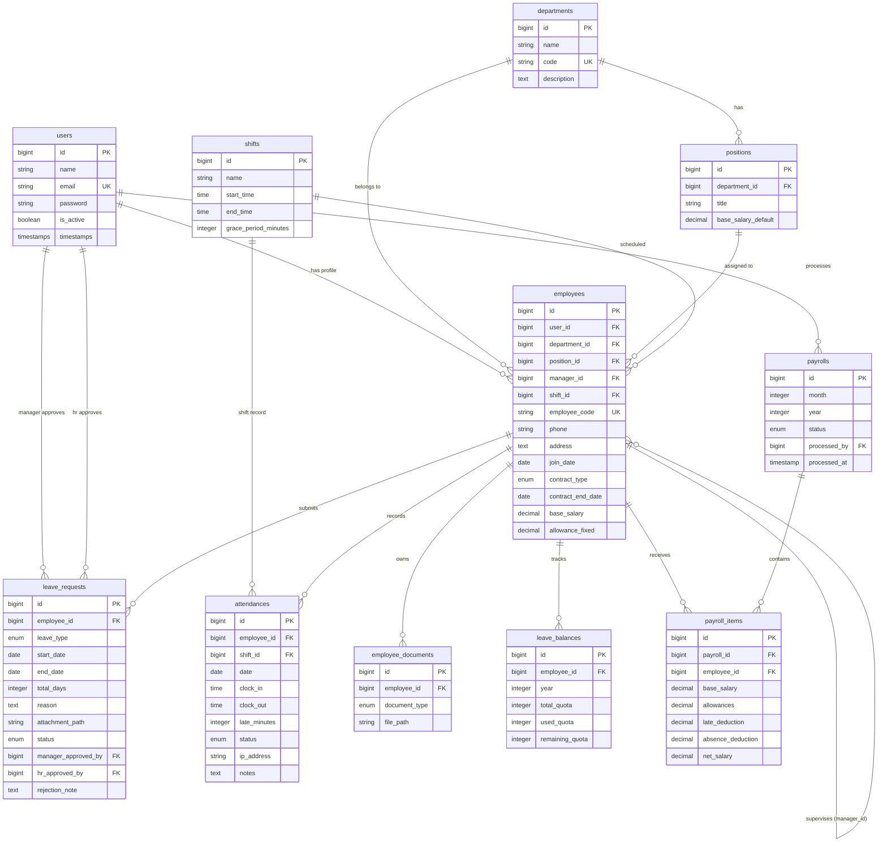

# NasHRIS — Enterprise Human Resource Information System

<p align="center">
  
  
  
  
  
  
  
</p>

---

## 1. Tentang Proyek (Overview)

**NasHRIS** adalah aplikasi web Enterprise Human Resource Information System (HRIS) modern dengan pendekatan desain *desktop-first responsive*. Aplikasi ini dirancang untuk mendemonstrasikan perancangan arsitektur database relasional berskala perusahaan, integritas transaksi data (`DB::transaction()`), kontrol hak akses berbasis peran (RBAC), alur persetujuan berjenjang (*multi-level approval workflow*), kalkulasi presensi & penggajian otomatis (*payroll engine*), serta jejak audit komprehensif (*audit trail*).

Dikembangkan secara monolitik menggunakan **Laravel 13**, **Tailwind CSS**, dan **Alpine.js** tanpa ketergantungan framework SPA (No React/Vue/Inertia/Livewire), NasHRIS menghadirkan performa server-side rendering yang sangat cepat, aman dari celah manipulasi URL (*Anti-IDOR*), dan siap digunakan untuk kebutuhan operasional perusahaan.

---

## 2. Fitur Utama & Keunggulan Arsitektur

### 🔐 1. Role-Based Access Control (RBAC) & One-Click Demo
- **3 Peran Pengguna Utama:**
  - **Super Admin / HR (`hr`):** Akses penuh pengelolaan master data, direktori karyawan, persetujuan cuti tahap final, generator payroll bulanan, analytics dashboard, dan audit log.
  - **Department Manager (`manager`):** Supervisi presensi tim divisi dan peninjau pengajuan cuti tahap 1 (*Pending Manager* &rarr; *Pending HR*).
  - **Employee Self-Service (`employee`):** Portal mandiri karyawan untuk Clock-In/Out harian, pengajuan cuti berlampiran, pemantauan saldo kuota cuti, dan unduh slip gaji PDF.
- **One-Click Demo Login:** Tombol akses instan di halaman login untuk eksplorasi setiap peran tanpa perlu registrasi manual.

### 🏢 2. Master Data & Direktori Karyawan Lengkap
- **Departemen & Jabatan:** Pengaturan struktur divisi dan batas gaji pokok default dengan proteksi integritas relasi foreign key.
- **Auto-Generated NIK:** Format kode karyawan terstandar otomatis `EMP-YYYY-XXX` (contoh: `EMP-2026-001`).
- **Manajemen Berkas & Anti-IDOR:** Unggah dan pratinjau dokumen digital (`KTP`, `NPWP`, `CV`, `CONTRACT`) yang dilindungi Laravel Policy (`EmployeeDocumentPolicy`).

### ⏱️ 3. Presensi Berbasis Shift & Otomatisasi Keterlambatan
- Master jadwal kerja shift dengan toleransi keterlambatan (*grace period*, default: 15 menit).
- Kalkulasi otomatis durasi keterlambatan dalam menit (`late_minutes`) dan penentuan status kehadiran (`Present`, `Late`, `Absent`, `On Leave`).
- Widget Clock-In / Clock-Out interaktif dengan jam realtime (Alpine.js) dan proteksi Clock-In ganda.
- Antarmuka koreksi absensi manual khusus HR.

### 🏖️ 4. Alur Persetujuan Cuti Berjenjang (Multi-Level Approval)
- Saldo cuti tahunan otomatis (default 12 hari/tahun) tersimpan pada tabel `leave_balances`.
- **Workflow Persetujuan 2 Tahap:**
  1. Karyawan mengajukan cuti &rarr; status: `Pending Manager`.
  2. Manager divisi mereview &rarr; jika disetujui, status menjadi `Pending HR`.
  3. HR memverifikasi akhir &rarr; status menjadi `Approved`, **kuota cuti otomatis dipotong**, dan **tabel presensi otomatis disinkronkan** menjadi `On Leave`.
  4. Jika ditolak pada tahap manapun, status menjadi `Rejected` disertai catatan penolakan dan saldo kuota tidak berkurang.

### 💰 5. Mesin Penggajian (Payroll Engine) & Slip Gaji PDF
- **Kalkulasi Formula Penggajian Bulanan Otomatis:**
  $$\text{daily\_rate} = \frac{\text{base\_salary}}{22}$$
  $$\text{minute\_rate} = \frac{\text{daily\_rate}}{480}$$
  $$\text{late\_deduction} = \text{total\_late\_minutes} \times \text{minute\_rate}$$
  $$\text{absence\_deduction} = \text{total\_absent\_days} \times \text{daily\_rate}$$
  $$\text{net\_salary} = (\text{base\_salary} + \text{allowances}) - (\text{late\_deduction} + \text{absence\_deduction})$$
- Dijalankan di dalam transaksi atomik `DB::transaction()`.
- Siklus batch penggajian dari status `Draft` hingga difinalisasi menjadi `Paid`.
- **Slip Gaji PDF Resmi:** Dibuat menggunakan `barryvdh/laravel-dompdf` dengan proteksi Anti-IDOR (`PayrollItemPolicy`), sehingga karyawan hanya dapat mengunduh slip gaji miliknya sendiri yang telah berstatus `Paid`.

### 📊 6. HR Analytics Dashboard & Audit Trail
- KPI Cards: Total Karyawan, Persentase Presensi Hari Ini, Cuti Menunggu Review HR, dan Estimasi Pengeluaran Payroll Bulanan.
- **Visualisasi Grafik Chart.js:**
  - *Doughnut Chart*: Distribusi proporsi karyawan per departemen.
  - *Multi-Line Chart*: Tren kedisiplinan 6 bulan terakhir (Hadir vs Terlambat vs Alpa).
- **Contract Expiry Reminder:** Widget otomatis untuk memantau karyawan berstatus `PKWT / Probation` yang kontraknya berakhir dalam **30 hari ke depan**.
- **Audit Log Viewer:** Penampil riwayat mutasi data dari `spatie/laravel-activitylog` lengkap dengan diff JSON perubahan atribut sebelum dan sesudah mutasi.

---

## 3. Diagram Alur & Arsitektur Sistem

### Alur Persetujuan Cuti Berjenjang (Multi-Level Approval Workflow)



### Entity-Relationship Diagram (ERD)



---

## 4. Kredensial Akun Demo (Demo Credentials)

Gunakan tombol **One-Click Demo Login** di halaman `/login` atau gunakan kredensial berikut:

| Peran (Role) | Nama Pengguna | Alamat Email | Password | Hak Akses Utama |
| :--- | :--- | :--- | :--- | :--- |
| **HR Administrator** | Siti Rahmawati | `hr@nashris.test` | `password` | Master Data, Payroll, HR Approval, Analytics, Audit Log |
| **Manager IT** | Bambang Wijaya | `manager.it@nashris.test` | `password` | Supervisi Presensi IT, Review Cuti Tahap 1 Tim IT |
| **Manager Finance** | Hendra Gunawan | `manager.fin@nashris.test` | `password` | Supervisi Presensi & Review Cuti Tim Finance |
| **Manager HR** | Rina Marlina | `manager.hr@nashris.test` | `password` | Supervisi Presensi & Review Cuti Tim HR |
| **Manager Marketing** | Dewi Lestari | `manager.mkt@nashris.test` | `password` | Supervisi Presensi & Review Cuti Tim Marketing |
| **Staff Employee** | Budi Santoso | `budi.santoso@nashris.test` | `password` | Clock-In/Out ESS, Pengajuan Cuti, Unduh Slip Gaji |

---

## 5. Panduan Instalasi & Menjalankan Lokal

### Prasyarat Sistem
- PHP 8.2 atau lebih tinggi (disarankan PHP 8.4)
- MySQL 8.0 (atau Laragon / XAMPP)
- Composer 2.x
- Node.js 18+ & npm

### Langkah Instalasi
1. **Clone repository:**
   ```bash
   git clone https://github.com/your-username/nashris.git
   cd nashris
   ```

2. **Install dependensi Composer:**
   ```bash
   composer install
   ```

3. **Install dependensi Node.js & build frontend assets:**
   ```bash
   npm install
   npm run build
   ```

4. **Konfigurasi file `.env`:**
   Salin `.env.example` ke `.env` dan sesuaikan koneksi database MySQL:
   ```env
   APP_NAME=NasHRIS
   APP_ENV=local
   APP_KEY=
   APP_DEBUG=true
   APP_URL=http://localhost:8000

   DB_CONNECTION=mysql
   DB_HOST=127.0.0.1
   DB_PORT=3306
   DB_DATABASE=nashris
   DB_USERNAME=root
   DB_PASSWORD=
   ```

5. **Generate Application Key:**
   ```bash
   php artisan key:generate
   ```

6. **Migrasi Database & Jalankan Realistic Seeder:**
   Perintah ini akan membuat seluruh tabel, Spatie roles, 4 departemen, 10 jabatan, 2 shift, 35 karyawan lengkap dengan relasi keluarga & kontrak, saldo cuti, serta rekaman absensi realistis:
   ```bash
   php artisan migrate:fresh --seed
   ```

7. **Jalankan Web Server Lokal:**
   ```bash
   php artisan serve
   ```
   Buka peramban Anda di `http://127.0.0.1:8000`.

---

## 6. Pengujian Otomatis (Automated Testing)

NasHRIS dilengkapi dengan unit dan feature tests komprehensif yang mencakup seluruh alur autentikasi, master data CRUD, otorisasi Anti-IDOR, kalkulasi keterlambatan presensi, persetujuan cuti berjenjang, hingga mesin penggajian dan audit log:

```bash
php artisan test
```

### Hasil Test Suite Terverifikasi:
```
   PASS  Tests\Unit\ExampleTest
  ✓ that true is true

   PASS  Tests\Feature\AuthTest (9 tests)
  ✓ root redirects to login for guests
  ✓ login screen can be rendered
  ✓ user can authenticate using the login screen
  ✓ user cannot authenticate with invalid password
  ✓ one click demo login as hr works
  ✓ one click demo login as manager works
  ✓ one click demo login as employee works
  ✓ user can logout
  ✓ dashboard requires authentication

   PASS  Tests\Feature\ExampleTest (1 test)
  ✓ the application returns a successful response

   PASS  Tests\Feature\Phase3MasterDataTest (8 tests)
  ✓ hr can view departments index
  ✓ hr can create department
  ✓ hr cannot delete department with employees
  ✓ hr can view and create position
  ✓ hr can view employee directory
  ✓ hr can create employee with auto generated nik and leave balance
  ✓ hr can upload and download document and anti idor protects other employees
  ✓ non hr cannot access hr master data routes

   PASS  Tests\Feature\Phase4AttendanceAndLeaveTest (13 tests)
  ✓ employee can view attendance page
  ✓ employee can clock in on time as present
  ✓ employee clocking in after grace period is marked late with correct minutes
  ✓ employee cannot clock in twice on same day
  ✓ employee can clock out
  ✓ manager can view only team members in their department
  ✓ hr can view all attendances and perform manual correction
  ✓ employee can submit leave request with status pending manager
  ✓ employee cannot submit annual leave exceeding quota
  ✓ manager step 1 approval transitions to pending hr
  ✓ manager from different department cannot review leave request
  ✓ hr step 2 final approval deducts quota and syncs attendance
  ✓ leave rejection workflow does not deduct quota

   PASS  Tests\Feature\Phase5PayrollTest (8 tests)
  ✓ hr can view payrolls index
  ✓ hr can generate monthly payroll draft for all employees
  ✓ payroll calculation accurately computes late and absence deductions
  ✓ hr can finalize payroll from draft to paid
  ✓ employee cannot view or download draft payslip
  ✓ employee can view and download their own paid payslip pdf
  ✓ employee cannot download another employees payslip anti idor
  ✓ non hr cannot generate or finalize payroll

   PASS  Tests\Feature\Phase6AnalyticsAndAuditTest (4 tests)
  ✓ hr can view analytics dashboard with kpi and charts
  ✓ hr can view audit logs index
  ✓ non hr cannot access analytics and audit logs
  ✓ model mutations automatically trigger activity logging

  Tests:    44 passed (139 assertions)
  Duration: 3.87s
```

---

## 7. Lisensi

NasHRIS dirilis di bawah lisensi terbuka [MIT License](LICENSE).
